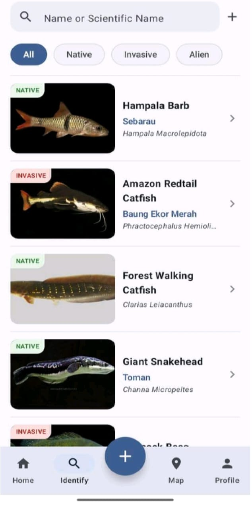

# InvaTrack: AI-Based Identification of Invasive Fish Species in Malaysia

Final Year Project, Bachelor of Computer Science (Computer Systems & Networking), Universiti Malaysia Pahang Al-Sultan Abdullah (UMPSA)

**Silver Award, FYPro-Com Exhibition 2026**

## About

InvaTrack is an Android app that identifies invasive fish species found in Malaysian waters from a photo, and lets users report and track sightings. [Add 1-2 sentences on the problem it solves, e.g. why invasive species are a concern and who the app is for.]

## Features

- **Fish identification:** take or upload a photo and get the predicted species with a confidence score, using an on-device TensorFlow Lite model
- **Species guide:** browse and search species, filter by Native / Invasive / Alien, and read details with a conservation status (habitat, diet, advice such as "do not release back into water")
- **Sighting reports:** report catches/sightings with location, with an option to keep the exact spot private
- **Map:** view reported sightings on a map
- **Statistics:** view sighting statistics
- **Community blog:** read and write blog posts
- **Accounts:** sign in with Google, manage your profile and your own reports

## Results

- More than 90% identification accuracy on [test set / number of test images]
- Dataset collected manually for the species below, with image augmentation to improve model performance

## Supported Species

African Catfish, Amazon Red-tail Catfish, Amazon Sailfin Catfish, Barramundi, Betta Imbellis, Betta Mahachai, Climbing Perch, Forest Walking Catfish, Giant Snakehead, Hampala Barb, Silver Barb, Striped Snakehead, Tinfoil Barb

## Tech Stack

| Area | Technology |
|---|---|
| Language / UI | Kotlin, Jetpack Compose (Material 3) |
| AI model | TensorFlow Lite (`best.tflite`) [add model type, e.g. YOLO / MobileNet] |
| Camera | CameraX |
| Backend | Firebase Authentication, Cloud Firestore, Cloud Storage |
| Maps | Google Maps Compose |
| Dependency injection | Koin |
| Image loading | Coil |

Minimum Android version: 10 (API 29)

## Screenshots

| Identify species | Identification result | Native species |
|---|---|---|
|  |  |  |

| Invasive species | Sightings map |
|---|---|
|  |  |

## Download

The latest APK is available under [Releases](https://github.com/fazrien-fz/InvaTrack/releases).

## Run From Source

1. Clone the repository:
   ```
   git clone https://github.com/fazrien-fz/InvaTrack.git
   ```
2. Open the project in Android Studio.
3. Create your own Firebase project, enable Authentication (Google), Firestore and Storage, then place your `google-services.json` in `app/`.
4. Add your Google Maps API key to `local.properties`:
   ```
   MAPS_API_KEY=your_key_here
   ```
5. Set your Google web client ID in `app/src/main/res/values/api_keys.xml`.
6. Run the app on a device or emulator with a camera.

> `google-services.json` and API keys are not included in this repository.

## Model and Dataset

The trained model is in `app/src/main/assets/best.tflite` with the class names in `labels.txt`. [Add a link to the dataset or training notebook, or note that the dataset is not included.]

## Author

**Fazrien Bin Zuki**
[LinkedIn](https://www.linkedin.com/in/fazrien-zuki/) · fazrien12@gmail.com

Supervisor: [Name, if you want to credit them]
