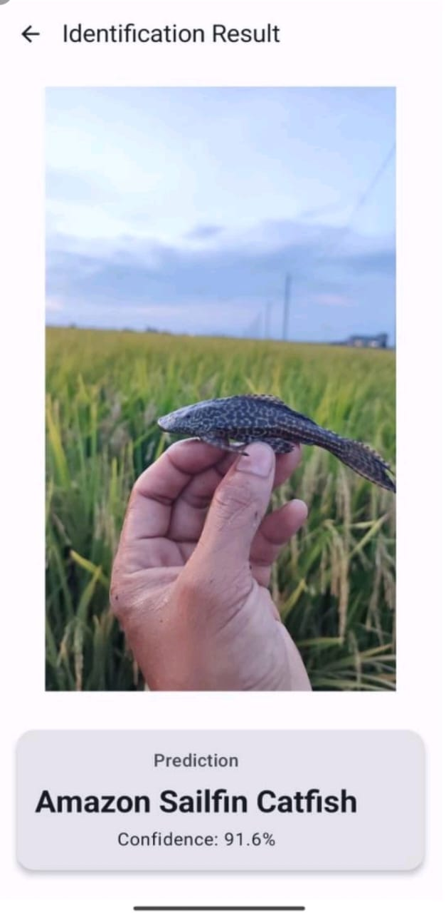
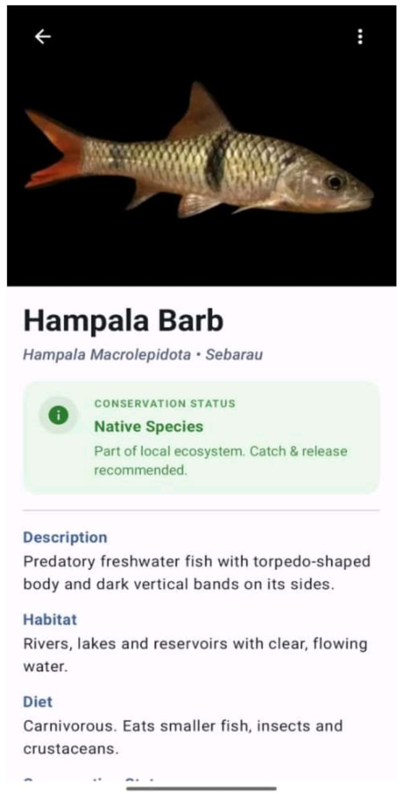
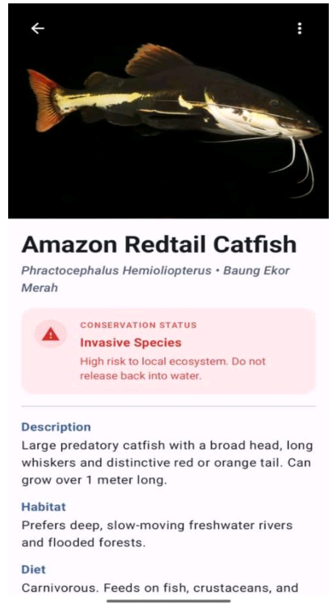
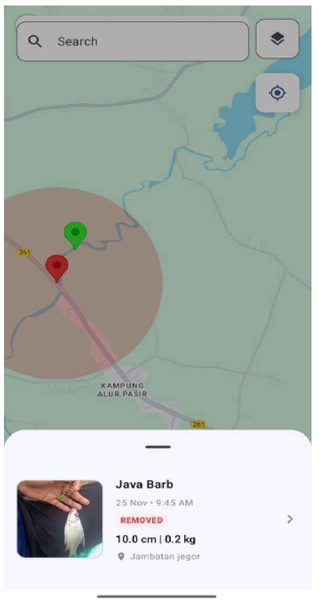

# InvaTrack: AI-Based Identification of Invasive Fish Species in Malaysia

## About

InvaTrack is an Android app that identifies invasive fish species found in Malaysian waters from a photo, and lets users report and track sightings.

## Features

- **Fish identification:** take or upload a photo and get the predicted species with a confidence score, using an on-device TensorFlow Lite model
- **Species guide:** browse and search species, filter by Native / Invasive / Alien and read details with a conservation status (habitat, diet, advice such as "do not release back into water")
- **Sighting reports:** report catches/sightings with location, with an option to keep the exact spot private
- **Map:** view reported sightings on a map

## Results

- More than 90% identification accuracy on 1000 datasets.
- Dataset collected manually for the species below, with image augmentation to improve model performance

## Supported Species

African Catfish, Amazon Red-tail Catfish, Amazon Sailfin Catfish, Barramundi, Betta Imbellis, Betta Mahachai, Climbing Perch, Forest Walking Catfish, Giant Snakehead, Hampala Barb, Silver Barb, Striped Snakehead, Tinfoil Barb

## Tech Stack

| Area | Technology |
|---|---|
| Language / UI | Kotlin, Jetpack Compose |
| AI model | TensorFlow Lite (`best.tflite`) [YOLOv11n] |
| Camera | CameraX |
| Backend | Firebase Authentication, Cloud Firestore, Cloud Storage |
| Maps | Google Maps Compose |

## Screenshots

| Identify species | Identification result | Native species |
|---|---|---|
|  |  |  |

| Invasive species | Sightings map |
|---|---|
|  |  |

